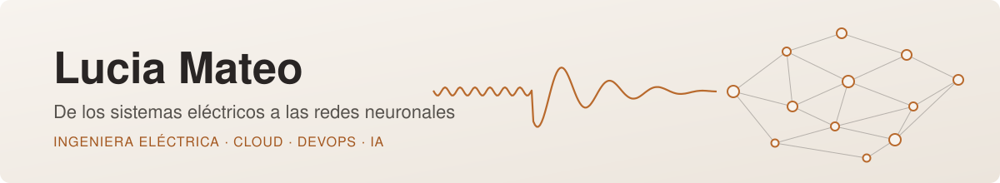

  

Ingeniera Eléctrica con más de 9 años de experiencia en el sector energético, especializada en la fiabilidad y el comportamiento dinámico de sistemas eléctricos de potencia. Ahora uno esa base con Cloud, DevOps e IA para contribuir a la transformación digital del sector energético.

## Proyectos en IA

| Proyecto | Qué demuestra |
|---|---|
| [Economicon (TFM)](https://github.com/EconomiconFinOps/tfm-economicon) | Trabajo de fin de máster: plataforma con backend, frontend, asistente de IA, CI/CD y especificaciones con OpenSpec |
| [Asistente turístico de Tenerife](https://github.com/lmatsan/tenerife-asistente-rag) | RAG sobre un PDF con ChromaDB y function calling con Gemini |
| [Aurum Market](https://github.com/lmatsan/aurum-market-busqueda-semantica) | Búsqueda semántica y control de catálogo con embeddings y Chroma |
| [Finetuning de Stable Diffusion](https://github.com/lmatsan/stable-diffusion-finetuning-libros-antiguos) | Finetuning completo con ilustraciones de libros antiguos |
| [Cancelaciones hoteleras](https://github.com/lmatsan/hotel-cancelaciones-ml) | Comparativa de modelos de Machine Learning (con Paris Arcos) |

## Del entorno físico al digital

- **De la fiabilidad del sistema a la resiliencia digital:** aplico el rigor del análisis de incidentes y la operación en tiempo real de la red eléctrica al diseño de sistemas digitales robustos y seguros.
- **De la simulación al Deep Learning:** llevo herramientas como PSS/E o Matlab hacia modelos de aprendizaje profundo para el análisis predictivo y la optimización de activos complejos.
- **Innovación con impacto:** en Elewit conecto los retos de la transición energética con soluciones tecnológicas avanzadas, automatizando procesos para escalar la eficiencia.

<strong>Trayectoria profesional</strong>

### Fiabilidad del Sistema Eléctrico (Red Eléctrica)
- **Análisis dinámico:** modelado y simulación del comportamiento de la red (PSS/E) y análisis de incidentes reales.
- **Optimización y simulación:** mejora de la capacidad de transporte (Dynamic Line Rating) y simulación por elementos finitos (Comsol Multiphysics).
- **Automatización:** herramientas de soporte a la operación en tiempo real con Python, Matlab y VBA.

### Innovación y Tecnología (Elewit)
- **Energy Partner:** conexión entre retos de negocio y soluciones tecnológicas avanzadas.
- **Transformación digital:** diseño de soluciones centradas en el usuario y alineadas con los objetivos estratégicos de la transición energética.

<strong>Stack técnico</strong>

- **Ingeniería:** PSS/E, análisis dinámico, ATP.
- **DevOps:** Docker, GitHub Actions, CI/CD, Makefile.
- **Cloud:** aprendiendo.
- **Lenguajes:** Python (avanzado), Matlab, VBA.
- **Inteligencia Artificial:** Machine y Deep Learning (en curso), bases de datos vectoriales.

  

